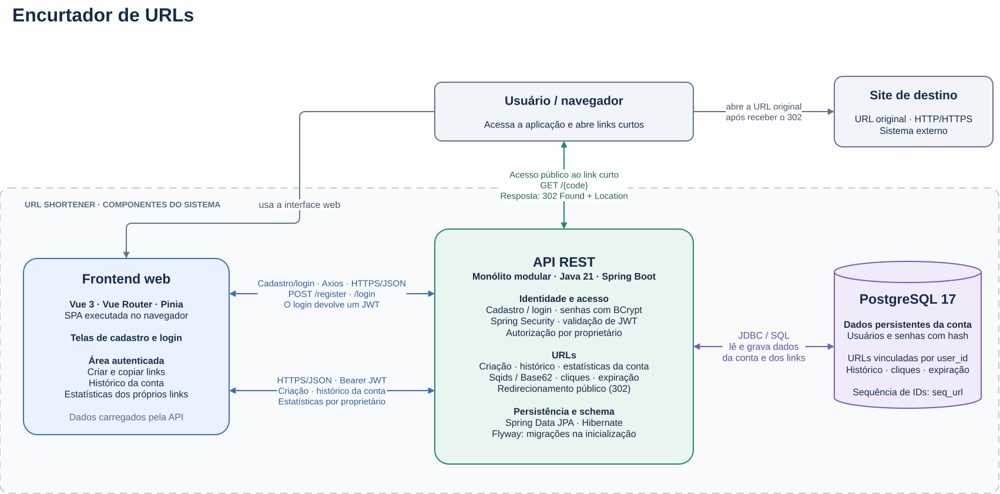

# GS. — Encurtador de URLs

Aplicação web para transformar URLs longas em links curtos, redirecionar para o destino original e acompanhar a quantidade de acessos.

> **Em desenvolvimento.** Projeto de portfólio com backend em Java e Spring Boot e frontend em Vue. A integração entre as funcionalidades está sendo construída; o estado atual e os próximos passos estão descritos abaixo.

O projeto reúne estudos práticos de APIs REST, autenticação, persistência relacional, concorrência, testes automatizados e integração entre frontend e backend.

[Estado atual](#estado-atual) · [Tecnologias](#tecnologias) · [Arquitetura](#arquitetura) · [Decisões técnicas](#decisões-técnicas) · [Executar localmente](#executar-localmente) · [API](#api) · [Testes e desempenho](#testes-e-desempenho) · [Documentação](#documentação) · [Próximos passos](#próximos-passos)

## Estado atual

| Funcionalidade | Situação |
| --- | --- |
| Encurtamento de URLs HTTP/HTTPS | Implementado, com validação de entrada e persistência no PostgreSQL. |
| Redirecionamento | Implementado com `302 Found` e cabeçalho `Location`. |
| Contagem de acessos | Implementada com incremento direto no banco de dados. |
| Estatísticas | API implementada: data de criação, total de cliques e URL original. Exige JWT. |
| Cadastro e login | Implementados no backend e na interface, com BCrypt e emissão de JWT. |
| Interface web | Criação, cópia, autenticação e histórico local dos últimos 20 links. |
| Estatísticas na interface | Painel integrado ao JWT do Spring Security. |
| Expiração de links | Data de 90 dias persistida; bloqueio de links expirados e ativação da limpeza agendada pendentes. |
| Infraestrutura local | PostgreSQL disponível pelo Docker Compose e Dockerfile para a API. A composição completa dos serviços está pendente. |

Após o login pela interface, o frontend armazena o JWT localmente e o envia como `Authorization: Bearer <token>` apenas nas chamadas a `/api/**`, conforme exigido pelo filtro de segurança.

## Tecnologias

| Camada | Tecnologias e ferramentas |
| --- | --- |
| Backend | Java 21, Spring Boot 4.1.1, Spring Web MVC e Bean Validation |
| Segurança | Spring Security, JWT com JJWT e BCrypt |
| Persistência | PostgreSQL 17, Spring Data JPA, Hibernate e Flyway |
| Geração de códigos | Sqids com alfabeto Base62 |
| Frontend | Vue 3, Composition API, Vue Router 4 e Pinia 3 |
| Interface e integração | Tailwind CSS 4, Lucide, Axios e Vite 7 |
| Testes | JUnit 5, Mockito, MockMvc, executor nativo do Node.js e k6 |
| Ambiente | Maven Wrapper, Docker e Docker Compose |

## Arquitetura

Visão de alto nível da arquitetura final pretendida, com login integrado ao frontend, autenticação JWT e histórico por usuário no PostgreSQL.



## Decisões técnicas

- **Organização por domínio:** o backend agrupa o código de URLs em `url/` e o de usuários em `user/`. Segurança e tratamento de erros compartilhados ficam em `shared/`.
- **Responsabilidades por camada:** controllers tratam o contrato HTTP, services concentram as regras de negócio e repositories fazem o acesso aos dados.
- **Códigos derivados de IDs:** uma sequência do PostgreSQL fornece o identificador usado pelo Sqids. A configuração utiliza Base62 e comprimento mínimo de seis caracteres. Sqids faz ofuscação; o código gerado não substitui uma regra de autorização.
- **Integridade no banco:** chaves primárias, chave estrangeira e restrições de unicidade protegem os dados. A unicidade do código também fornece o índice usado em sua consulta.
- **Incremento de cliques no banco:** a operação `click_count = click_count + 1` evita que leituras e gravações separadas na aplicação percam incrementos concorrentes.
- **Schema versionado:** o Flyway aplica as migrações, enquanto o Hibernate está configurado com `ddl-auto: validate` para validar o mapeamento.
- **Histórico na aba:** o Pinia mantém até 20 links em memória enquanto a aba está aberta. Esse histórico não é uma listagem de links vinculados a uma conta.

## Executar localmente

### Pré-requisitos

- JDK 21.
- Docker com Docker Compose.
- Node.js `20.19+` na série 20 ou versão `22.12+`, conforme `frontend/package.json`.
- OpenSSL para gerar a chave JWT.

O Maven Wrapper está incluído no repositório. Os comandos abaixo usam Bash e devem começar na raiz do projeto.

### 1. Obter o projeto e configurar o backend

```bash
git clone https://github.com/GuilhermeSaar/Url-Shortener.git
cd Url-Shortener
cp .env.example .env
openssl rand -base64 48
```

Copie a chave gerada para `JWT_SECRET` no arquivo `.env`. A aplicação lê esse arquivo quando é iniciada pela raiz do repositório.

| Variável | Uso | Configuração local |
| --- | --- | --- |
| `SPRING_DATASOURCE_URL` | Conexão JDBC | `jdbc:postgresql://localhost:5432/url_shortener` |
| `SPRING_DATASOURCE_USERNAME` | Usuário do banco | `postgres` |
| `SPRING_DATASOURCE_PASSWORD` | Senha do banco | Vazia no Compose atual |
| `JWT_SECRET` | Chave de assinatura JWT | Chave Base64 gerada no passo anterior |
| `JWT_EXPIRATION_MS` | Validade do token em milissegundos | `3600000` — uma hora |

O Compose atual configura o PostgreSQL com autenticação `trust`, sem senha, para desenvolvimento local. O arquivo `.env` é ignorado pelo Git.

### 2. Iniciar o banco e a API

```bash
docker compose up -d db
docker compose ps
```

Aguarde o banco aparecer como `healthy` e inicie a aplicação:

```bash
./mvnw spring-boot:run
```

A API fica disponível em `http://localhost:8080`. O Flyway cria o schema a partir das migrações em `src/main/resources/db/migration/`.

### 3. Iniciar o frontend

Em outro terminal, a partir da raiz:

```bash
cd frontend
npm ci
npm run dev
```

Abra o endereço informado pelo Vite, normalmente `http://localhost:5173`.

Durante o desenvolvimento, o Vite encaminha `/shorten`, `/register`, `/login` e `/api` para `http://localhost:8080`. Os links curtos devolvidos pela API apontam para o backend, que executa o redirecionamento e contabiliza os acessos.

Para configurar outra base da API, consulte [`frontend/.env.example`](frontend/.env.example) e as [orientações do frontend](frontend/README.md). O proxy de desenvolvimento não é incluído no build de produção.

### Encerrar o ambiente

Interrompa a API e o Vite com `Ctrl+C` nos respectivos terminais. Para parar o PostgreSQL:

```bash
docker compose down
```

Os dados permanecem no volume `postgres_data`.

## API

Base local: `http://localhost:8080`.

| Método | Endpoint | Autenticação | Resultado esperado |
| --- | --- | --- | --- |
| `POST` | `/shorten` | Público | `201` com a URL curta |
| `GET` | `/{code}` | Público | `302` para o destino original |
| `POST` | `/register` | Público | `201` com cadastro concluído |
| `POST` | `/login` | Público | `200` com o token JWT |
| `GET` | `/api/url/{code}` | Bearer JWT | `200` com estatísticas |

### Criar um link

```bash
curl -i http://localhost:8080/shorten \
  -H 'Content-Type: application/json' \
  -d '{"url":"https://example.com/artigo"}'
```

Exemplo de corpo da resposta:

```json
{
  "response": "http://localhost:8080/aB3xYz"
}
```

O código é gerado pela aplicação. Nos próximos exemplos, substitua `aB3xYz` pelo código recebido.

### Acessar o link curto

```bash
curl -i http://localhost:8080/aB3xYz
```

A resposta contém `302 Found` e o cabeçalho `Location` com a URL original. Esse acesso incrementa o contador. A consulta de estatísticas não incrementa os cliques.

### Cadastrar e autenticar um usuário

```bash
curl -i http://localhost:8080/register \
  -H 'Content-Type: application/json' \
  -d '{"email":"dev@example.com","password":"senha-exemplo-123"}'

curl -i http://localhost:8080/login \
  -H 'Content-Type: application/json' \
  -d '{"email":"dev@example.com","password":"senha-exemplo-123"}'
```

O login devolve o token no campo `token`. Utilize seu valor no cabeçalho da consulta:

```bash
curl -i http://localhost:8080/api/url/aB3xYz \
  -H 'Authorization: Bearer COLE_O_TOKEN_AQUI'
```

Exemplo de corpo da resposta:

```json
{
  "date": "2026-10-22T10:30:00",
  "clickCount": 1,
  "urlOriginal": "https://example.com/artigo"
}
```

Entradas inválidas retornam `400`, códigos inexistentes retornam `404` e e-mails já cadastrados retornam `409`. A consulta de estatísticas sem autenticação retorna `401`.

Atualmente, links são criados sem vínculo com o usuário e qualquer usuário autenticado pode consultar as estatísticas de um código existente. A autorização por proprietário faz parte dos próximos passos.

A [coleção do Insomnia](insomnia/url-shortener-insomnia.json) reúne exemplos de criação, validação, redirecionamento, cadastro, login e estatísticas autenticadas.

## Testes e desempenho

### Testes automatizados disponíveis

O repositório contém testes unitários de serviços e controllers, testes de integração com o contexto Spring e um cenário de concorrência para o contador de cliques. No frontend, os testes verificam o contrato HTTP com respostas controladas, a renderização inicial da home e o roteamento.

Para executar os testes unitários do backend, na raiz:

```bash
./mvnw -Dtest=UrlServiceTest,ShortenUrlControllerTest,UrlControllerTest,AuthServiceTest,UserServiceTest test
```

Para executar a suíte completa, com o PostgreSQL disponível:

```bash
./mvnw test
```

Os testes de integração usam o banco configurado pela aplicação. O teste de concorrência cria um pool de 5.000 threads; a execução completa exige recursos compatíveis e um banco de desenvolvimento/testes.

Para executar os testes e compilar o frontend, a partir da raiz:

```bash
cd frontend
npm test
npm run build
```

### Resultados locais documentados

Os relatórios registram medições realizadas em **15/10/2026**, nas condições descritas em cada documento. Eles antecedem mudanças posteriores no projeto e precisam ser reavaliados conforme a implementação evoluir.

| Cenário | Resultado registrado | Relatório |
| --- | --- | --- |
| Criação de URLs | 1.829 criações em três minutos; vazão média de 10,14 criações/s | [RNF04 — Volume de criação](docs/RNF04-Volume-de-Criacao.md) |
| Redirecionamento | 6.000 requisições a 50 req/s; p95 de 4,47 ms | [RNF07 — Latência](docs/RNF07-Latencia.md) |
| Massa persistida | 1.790.676 URLs com códigos distintos na coleta | [RNF05 — Capacidade](docs/RNF05-Capacidade.md) |

A capacidade para **365 milhões de URLs é uma projeção de armazenamento** baseada na massa medida. Esse volume não foi utilizado nos testes documentados.

Com a API e o banco em execução e o k6 instalado, os scripts podem ser executados a partir da raiz:

```bash
k6 run load-test/RNF04-test.js
BASE_URL=http://localhost:8080 SHORT_CODE=aB3xYz k6 run load-test/RNF07-test.js
```

Use um código existente no segundo comando. O teste de criação adiciona registros ao banco e o de redirecionamento incrementa o contador do link escolhido.

## Estrutura do repositório

```text
.
├── src/main/java/com/urlshortener/
│   ├── configuration/       # Configuração do Spring Security
│   ├── shared/              # JWT e tratamento compartilhado de erros
│   ├── url/                 # Controllers, serviços, persistência e expiração
│   └── user/                # Cadastro, autenticação e modelo de usuário
├── src/main/resources/
│   ├── db/migration/        # Migrações Flyway
│   └── application.yaml    # Configuração da API
├── src/test/               # Testes do backend
├── frontend/
│   ├── src/                # Views, componentes, rotas, serviços e stores
│   └── tests/              # Testes do frontend
├── docs/                   # Requisitos e relatórios de desempenho
├── insomnia/               # Coleção de requisições da API
├── load-test/              # Cenários de carga com k6
├── .env.example            # Modelo de configuração local
├── Dockerfile              # Build e imagem de execução da API
└── docker-compose.yml      # PostgreSQL para desenvolvimento
```

## Documentação

- [Requisitos do backend](docs/Requisitos-back.md): escopo funcional, metas e restrições técnicas.
- [Requisitos e documentação do frontend](docs/Requisitos-front.md): interface, acessibilidade e contrato de integração do protótipo.
- [Guia do frontend](frontend/README.md): desenvolvimento, build, rotas e limitações.
- [Volume de criação — RNF04](docs/RNF04-Volume-de-Criacao.md).
- [Capacidade acumulada — RNF05](docs/RNF05-Capacidade.md).
- [Latência de redirecionamento — RNF07](docs/RNF07-Latencia.md).

Os requisitos descrevem o escopo pretendido. A seção [Estado atual](#estado-atual) registra o que está implementado e as integrações pendentes.

## Próximos passos

Prioridades identificadas a partir do estado atual do código:

- [x] Integrar cadastro, login e envio de JWT no frontend.
- [ ] Vincular os links aos usuários e definir a autorização das estatísticas por proprietário.
- [ ] Concluir a retenção: bloquear links expirados nas consultas, habilitar a limpeza agendada, permitir alterar a expiração e avaliar um índice para `expires_at`.
- [ ] Conciliar o requisito de códigos com exatamente seis caracteres com o `minLength(6)` do Sqids e o limite da coluna no banco.
- [ ] Incluir a API e o frontend no Docker Compose.
- [ ] Ampliar os testes de autenticação, autorização e expiração e automatizar as verificações em CI.
- [ ] Atualizar as medições de carga e registrar ambiente, recursos e versão do código utilizados.
- [ ] Adicionar uma demonstração visual da interface e instruções de publicação.

---

Projeto de portfólio de [GuilhermeSaar](https://github.com/GuilhermeSaar).
